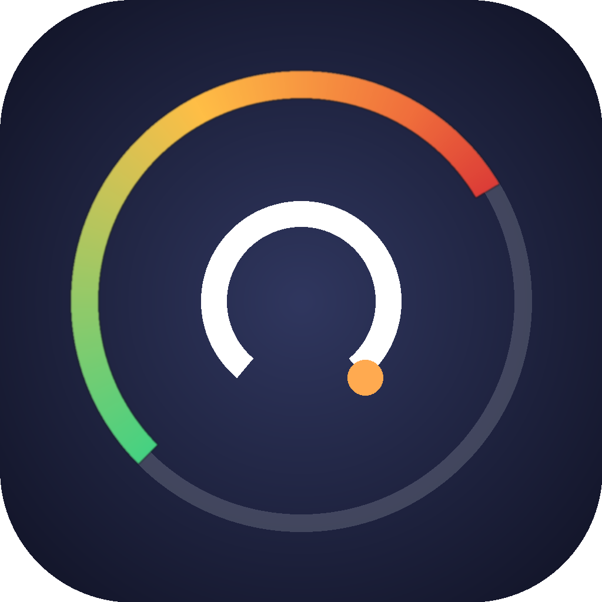

<p align="center">
  
</p>

# ClaudeStats

A native macOS menu bar app that shows your Claude Code usage at a glance — with a **pace-aware** indicator that tells you whether you're burning through your 5-hour and weekly limits faster or slower than a steady budget.

Built with SwiftUI + AppKit (`NSStatusItem` + `NSPopover`). No Dock icon, no telemetry, no background services.

---

## What you see

**Menu bar item**
- Customizable pace glyphs for under / on / over pace (default: tortoise / gauge / hare, 30+ SF Symbols to choose from)
- Configurable display: % used, % remaining, % used / % pace, time to reset, or icon only
- Compact mode hides the glyph for a minimal footprint
- If no 5h data is available yet (e.g. cold start), shows hourglass + your weekly percentage
- If not signed in, shows a question-mark icon + "ClaudeStats" — clicking it goes straight to Settings
- Right-click context menu with Settings, About, Quit, and a Launch at Login toggle

**Popover** (click the menu bar item)
- **5-hour window** card with a ring gauge: the colored arc shows how much of your window budget you've consumed, and a marker shows where you should be based on elapsed time. If the arc ends before the marker you're ahead of budget; past it, you're burning fast. The ring color follows your pace (green → mint → yellow → orange → red).
- **Weekly** card with one ring per weekly cap in the same gauge: the outer ring is the global 7-day cap, and each **per-model weekly cap** (e.g. **Fable**) adds an inner ring with its own pace color. A cap appears automatically when it exists on your account; nothing to configure.
- Pace status, reset countdown, elapsed time and projected end-of-window usage for every limit
- **Codex** card for your ChatGPT plan (e.g. **Codex · Plus**): one ring per Codex limit (5-hour window and weekly), with pace and reset time. It appears when you sign in with a code in Settings, or when the Codex CLI is signed in with a ChatGPT account (see [Codex usage](#codex-usage)).
- Per-model breakdown (Opus / Sonnet / Haiku) as a segmented bar with a legend, for the 5-hour window and the week
- **Activity heatmap** — GitHub-style grid of the last 13 weeks; each day is shaded relative to your busiest day in view (togglable in Settings, applies live)
- Icon footer (Refresh, History, Settings, About, Quit) and a small ring that counts down to the next refresh
- Subtle animations: gauges fill in when the popover opens, numbers roll when they change

**Settings** (Settings button in the popover)
- Sign in to Claude.ai via email (embedded WKWebView), Google (`ASWebAuthenticationSession` in your default browser), or paste your `sessionKey` manually
- **ChatGPT · Codex** — **Sign in with a code** to any ChatGPT account (the app shows a code, you enter it at `auth.openai.com/codex/device`), or use the Codex CLI sign-in. Shows the account and plan in use, and lets you hide the Codex card in the popover and desktop overlay.
- **Menu bar display** — choose between: % used (default), % remaining, % used / % pace, time to reset, or icon only. The **% used / % pace** mode shows two numbers side by side — how much of your window budget you've actually consumed vs. the theoretical percentage you'd be at if you'd burned it evenly over elapsed time. If the first number is below the second you're ahead of budget; above it, you're burning fast.
- **Pace icons** — pick any SF Symbol for under-pace, on-pace, and over-pace states from a curated list of 30+ glyphs (tortoise, gauge, hare, bolt, flame, battery levels, dials, and more)
- **Compact menu bar** — hides the pace glyph, showing only the text value. Automatically disabled when "Icon only" is selected.
- **Global keyboard shortcut** — set a hotkey to toggle the popover from anywhere. Uses the Carbon `RegisterEventHotKey` API — no Accessibility permissions required.
- **Show activity heatmap in popover and desktop overlay** — toggles the inline heatmap; applies live, no restart needed.
- **Desktop overlay** — pin a glass, non-interactive widget to any corner of any screen: the 5-hour and weekly ring gauges side by side (including any model-scoped weekly caps), the Codex gauge when ChatGPT is connected, the activity heatmap, and a watermark pace glyph. Pick the background colour and its opacity: 0% leaves only the gauges, 100% gives a solid card. Respects Dock placement and repositions instantly when the Dock shows/hides.
- Toggle Launch at Login
- **Check for updates** — queries the GitHub Releases API; if a newer version is available you can **Install & restart** in-place. Works whether the app lives in `/Applications/` or anywhere else.
- **Check for updates automatically at startup** — when enabled, the app checks for a newer release each launch and shows a native macOS confirmation dialog (Update now / Later) before installing.

**Usage History** (History button in the popover footer)
- **Stat tiles** — current streak, active days in the last 90 days, tokens in the last 7 days, and your best day
- **Last 14 days** — Swift Charts bar chart of daily billable tokens, stacked by model, with a hover tooltip per day
- **Activity heatmap** — 13-week GitHub-style grid with month labels, weekday labels, and tooltips

**About** (About button in the popover footer)
- App icon, current version, author, contact email, project URL, and license link.

---

## How it works

When you sign in to Claude.ai through the app, it calls Anthropic's own undocumented but browser-accessible endpoint:

```
GET https://claude.ai/api/organizations/{orgId}/usage
```

This is the exact endpoint used by Claude's in-page `/usage` view. It returns your real 5-hour and 7-day utilization percentages plus actual reset timestamps, straight from Anthropic. No guessing, no local approximation.

Your `sessionKey` cookie is stored in your app preferences plist. Cleared when you sign out.

**Per-model breakdown** comes from parsing your local Claude Code session logs at `~/.claude/projects/*/*.jsonl` — the `/usage` endpoint returns aggregate percentages only, not a per-model split. Internal Claude Code messages tagged `<synthetic>` (tool-result wrappers, session-interrupted notices) are filtered out so the percentages reflect only real API calls.

### Codex usage

ClaudeStats can also show the Codex limits of your ChatGPT plan (Plus, Pro…). It calls the same endpoint the [Codex CLI](https://github.com/openai/codex) uses to show its own limits:

```
GET https://chatgpt.com/backend-api/wham/usage
```

The response has the real used percentage, window length and reset time of each Codex limit. There are two ways to sign in:

- **Sign in with a code** (Settings → ChatGPT · Codex). This is the same device-code flow as `codex login --device-auth`, with the Codex CLI's public client ID: the app shows a code, opens `auth.openai.com/codex/device`, and waits until you approve it. The session belongs to ClaudeStats and is separate from Codex, so you can use a different account. The app refreshes its tokens itself (access tokens last about one hour). OpenAI's official "Sign in with ChatGPT" for open-source apps was tried first: sign-in works, but the usage endpoint rejects its tokens with HTTP 401.
- **The Codex CLI sign-in**, used when there is no own sign-in. The app reads the access token from `~/.codex/auth.json` on every refresh and never stores or refreshes it, so it does not interfere with Codex. If the token expires, run `codex` once and it refreshes it.

This only covers Codex. Messages you send in the ChatGPT app or on chatgpt.com are not reported anywhere, so they cannot be shown.

**Refresh cadence:** every 30 seconds. Manual refresh via the Refresh button.

---

## System requirements

- **macOS 14 Sonoma** or later (uses `@Observable` and Swift Charts). On macOS 26 or later the desktop overlay uses Liquid Glass; earlier versions get a translucent material instead.
- Apple Silicon or Intel (universal binary)
- A paid Claude subscription (Pro, Max 5×, or Max 20×) — the app doesn't support Free or API-key-only accounts
- Claude Code installed locally — used for the per-model breakdown via `~/.claude/projects/`

---

## Installation

**Grab the built app:**
```sh
cp -R build/ClaudeStats.app /Applications/
open /Applications/ClaudeStats.app
```

First launch may prompt Gatekeeper because the app is ad-hoc signed. Right-click the app in Finder → **Open** → **Open** in the dialog. You only have to do this once.

**Launch at login** only works reliably when the app lives in `/Applications/` — `SMAppService` registers against the app bundle path.

---

## Building from source

Requirements:
- Xcode 15+ (for the Swift 5.9 toolchain)
- Python 3 with Pillow (only if regenerating the icon: `pip install Pillow`)

```sh
# Build a release binary and assemble the .app bundle
./scripts/build-app.sh

# Regenerate the app icon (optional)
python3 scripts/make-icon.py
```

The build script:
1. Runs `swift build -c release` (arm64 + x86_64 when possible, falls back to host arch)
2. Assembles `build/ClaudeStats.app` with `Info.plist`, binary, icon, and SwiftPM resource bundles
3. Ad-hoc codesigns the bundle (required for `SMAppService` to work)

---

## Signing in

Inside the app, open **Settings** to sign in.

**Supported login methods:**
- **Google** — uses `ASWebAuthenticationSession`, which opens your default browser (Safari, Chrome, Edge, etc.) for OAuth. Google can't block this because it's a real browser, not an embedded web view. After login, the app polls `HTTPCookieStorage` to auto-capture the `sessionKey` cookie. If auto-capture fails, you'll be prompted to paste the cookie manually.
- **Email** — opens an embedded WKWebView at `claude.ai/login`. Magic link won't work inside the embedded window, but if your browser session is already authenticated via the same cookie, you may not need to log in again.
- **Manual cookie paste** — expand "Paste sessionKey manually" in Settings (always works as a fallback).

**Manual paste flow:**
1. Open claude.ai in Safari or Chrome while logged in
2. DevTools (⌥⌘I) → Application → Cookies → `https://claude.ai`
3. Copy the value of the `sessionKey` cookie
4. Paste into the app's Settings

The app then fetches your organization ID automatically and starts polling `/usage`.

---

## Privacy

- All data stays on your Mac. No external services apart from claude.ai itself, and chatgpt.com when Codex is signed in.
- ChatGPT tokens from **Sign in with a code** are stored in the same preferences plist and only sent to auth.openai.com and chatgpt.com. **Sign out** deletes them.
- The Codex CLI token is only read from `~/.codex/auth.json` and only sent to chatgpt.com. It is never copied or logged.
- Your session cookie is stored locally in the app's UserDefaults plist (`~/Library/Preferences/name.horta.albert.ClaudeStats.plist`).
- No analytics, no telemetry, no crash reporting.
- Source is all in this repo — audit it.

---

## Known limitations

- **Claude.ai session endpoint is undocumented.** It could change shape or disappear at any time; if that happens the pace sections will simply go blank until the app is updated.
- **Weekly Opus cap is not separately shown.** Anthropic tracks it internally but the `/usage` endpoint doesn't return it, so the weekly bar represents the combined 7-day limit.
- **The chatgpt.com usage endpoint is undocumented too.** If it changes, the Codex card shows an error until the app is updated. The app asks it every 30 seconds; if chatgpt.com starts to answer HTTP 429, the refresh interval for Codex must be longer.
- **Sign-in is required.** Without a claude.ai session the pace sections have no data to show.

---

## Project layout

```
ClaudeStats/
├── Package.swift                       swift-tools-version 5.9, macOS 14
├── Resources/
│   ├── Info.plist                      LSUIElement=true, bundle metadata
│   └── AppIcon.icns                    generated by scripts/make-icon.py
├── Sources/ClaudeStats/
│   ├── App.swift                       AppKit @main entry, AppDelegate, PopoverToggle
│   ├── Resources/                      spark images for the 5-hour gauge
│   ├── Core/
│   │   ├── JsonlUsageReader.swift      Streams ~/.claude/projects/*/*.jsonl for per-model split
│   │   ├── StatsStore.swift            Observable store, pace math, remote refresh
│   │   ├── Scope.swift                 UsageScope enum (5h, Week)
│   │   ├── Keychain.swift              Thin UserDefaults shim (misnomer kept)
│   │   ├── ClaudeAIClient.swift        GET /api/organizations/{id}/usage
│   │   ├── ChatGPTLogin.swift          Device-code ChatGPT sign-in and token refresh
│   │   ├── CodexClient.swift           GET chatgpt.com/backend-api/wham/usage
│   │   ├── UpdateChecker.swift         GitHub Releases API check
│   │   ├── UpdateInstaller.swift       Self-update: download zip, swap bundle, relaunch
│   │   ├── LaunchAtLogin.swift         SMAppService wrapper
│   │   ├── StatusBarController.swift   NSStatusItem + NSPopover, button config, context menu
│   │   ├── HotkeyManager.swift        Carbon RegisterEventHotKey global shortcut
│   │   └── UsageHistory.swift         Daily summaries, streak calculation, heatmap data
│   └── UI/
│       ├── Theme.swift                 Shared colors, cards, gauges, pace bar, heatmap, icon buttons
│       ├── SupperGauge.swift           Ring gauge (vendored copy of the SupperGauge package)
│       ├── PopoverView.swift           Main popover layout
│       ├── HistoryView.swift           Usage History window (stat tiles, Swift Charts, heatmap)
│       ├── SettingsView.swift          Sign-in, display, launch-at-login, updates
│       ├── SignInWindow.swift          WKWebView (email) + ASWebAuthenticationSession (Google)
│       ├── DesktopOverlay.swift        Non-interactive desktop widget + overlay manager
│       └── AboutWindow.swift           About panel
└── scripts/
    ├── build-app.sh                    swift build → .app bundle → codesign
    └── make-icon.py                    Pillow-generated AppIcon.icns
```

---

## Credits

- The `/api/organizations/{orgId}/usage` endpoint and its response shape were identified by studying [she-llac/claude-counter](https://github.com/she-llac/claude-counter), a MIT-licensed browser extension that does the same thing in the browser. Huge thanks.
- The OpenAI logo in the Codex gauge comes from [Simple Icons](https://simpleicons.org) (CC0). OpenAI and its logo are trademarks of OpenAI; this project is not affiliated with OpenAI.

---

## License

ClaudeStats is licensed under the **MIT License**. See [`LICENSE`](./LICENSE) for the full text.

This project incorporates knowledge derived from [she-llac/claude-counter](https://github.com/she-llac/claude-counter) — specifically its identification of the `/api/organizations/{orgId}/usage` endpoint and response shape. `claude-counter` is also MIT-licensed.
